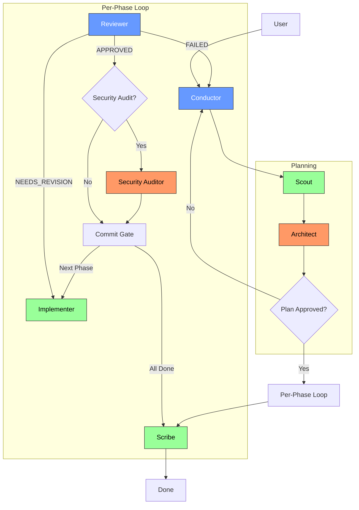
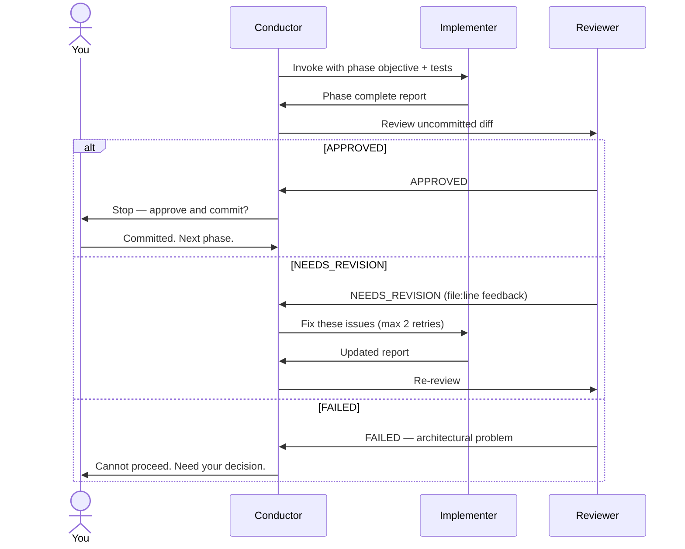
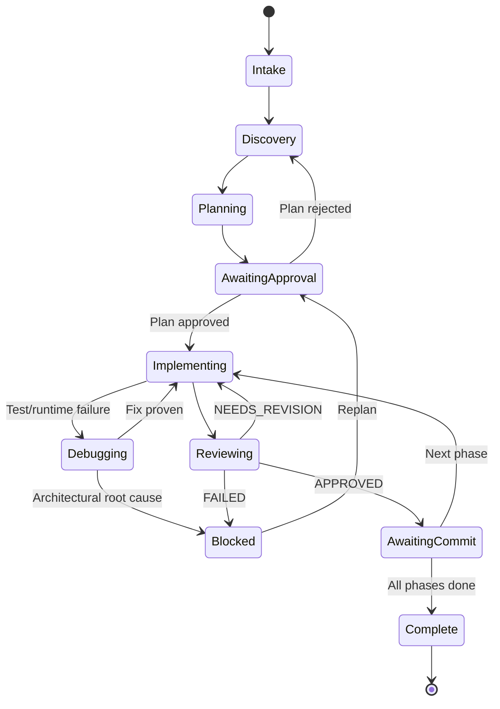

# Conductor Agents

A multi-agent orchestration pack for AI coding tools. Eight specialised sub-agents coordinated by a Conductor through a disciplined **discovery → plan → implement → review → commit** lifecycle. One pack, three harnesses.

## What This Is

Instead of one agent doing everything in a single chat session, you break work into specialised roles. Each sub-agent gets a fresh, small context window and runs on the cheapest model that does its job well. The Conductor manages the lifecycle and enforces mandatory review gates — the plan must be approved before implementation starts, each phase must pass review before the next begins, and no code is committed by an agent.

## Agents at a Glance

| Agent | What it does | Tier | When it runs |
|---|---|---|---|
| **Conductor** | Orchestrates, asks clarifying questions, enforces the lifecycle | Sonnet | You invoke it at the start |
| **Scout** | Searches the codebase, finds relevant files and patterns | Haiku | Once per task, during discovery |
| **Architect** | Produces a phased implementation plan | Opus | Once per task, after discovery |
| **Implementer** | Writes code and tests, one phase at a time | Haiku | Every phase |
| **Reviewer** | Quality gate — reviews uncommitted diffs | Sonnet | After every phase |
| **Security Auditor** | Adversarial security review | Opus | Conditionally (auth, crypto, secrets, etc.) |
| **Debugger** | Root-cause analysis of test/runtime failures | Sonnet | On failure, or by direct invocation |
| **Scribe** | Phase records, changelogs, docstrings, summaries | Haiku | After all phases, or by direct invocation |

The Conductor is the only agent you interact with directly. It invokes the others as needed and stops at mandatory gates for your approval.

## Choose Your Harness

| Harness | Agent directory | Presses |
|---|---|---|
| **GitHub Copilot** | `harnesses/copilot/` → `.github/agents/*.agent.md` | VS Code Insiders + Copilot subscription |
| **Claude Code** | `harnesses/claude-code/` → `.claude/agents/*.md` | Claude Code CLI + Anthropic account |
| **OpenCode** | `harnesses/opencode/` → `.opencode/agent/*.md` | OpenCode CLI + any provider |

## Installation

Pick your harness, copy its dot-directory into your project root:

**Copilot:**
```bash
cp -r harnesses/copilot/.github .github/
cp -r harnesses/copilot/.vscode .vscode/
```

**Claude Code:**
```bash
cp -r harnesses/claude-code/.claude .claude/
```

**OpenCode:**
```bash
cp -r harnesses/opencode/.opencode .opencode/
cp harnesses/opencode/opencode.json opencode.json
```

Global installation (available across all projects) is also supported:

**Copilot** — copy `.github/agents/*.agent.md` to `~/.vscode/agent-files/` and add the path to `chat.agentFilesLocations` in your VS Code settings.

**Claude Code** — copy `.claude/agents/*.md` to `~/.claude/agents/` and `.claude/commands/*.md` to `~/.claude/commands/`.

**OpenCode** — copy `.opencode/agent/*.md` to `~/.config/opencode/agent/` and `opencode.json` to `~/.config/opencode/`.

## Quick Start

1. Open your project in your chosen harness.
2. Select **Conductor** as your agent.
3. Paste a task description.

**Good request:**
> Add rate limiting to the Express API. 100 requests per minute per IP, configurable via environment variable, with a 429 response when exceeded. Use the existing redis client in src/db/redis.ts. Write tests with Jest.

**Vague request (will be bounced back):**
> Add rate limiting.

The Conductor will restate the task, ask clarifying questions if anything is ambiguous, and won't proceed until scope is confirmed.

## The Workflow



### What happens at each step

1. **Intake** — Conductor restates your task, asks clarifying questions, confirms scope.
2. **Discovery** — Scout searches the codebase and returns what files matter, what patterns exist, how tests are set up.
3. **Planning** — Architect produces a phased plan (3–10 phases, 1–3 files each). Conductor writes it to `plans/<slug>-plan.md`.
4. **Stop — you review and approve the plan.** No code is written until you say yes.
5. **For each phase:**
   - Implementer writes code (TDD: test first, confirm it fails, write code, confirm it passes, lint).
   - Reviewer checks the uncommitted diff. Returns `APPROVED`, `NEEDS_REVISION` (with `file:line` feedback), or `FAILED` (architectural problem — stops the workflow).
   - If the phase touches auth, crypto, secrets, user input, or network boundaries, the Security Auditor runs.
   - Conductor writes a phase-complete record to `plans/<slug>-phase-<N>-complete.md`.
   - **Stop — you commit.** The Conductor suggests a Conventional Commits message.
6. **Completion** — Scribe produces a final summary and changelog entry to `plans/<slug>-complete.md`.

### Review verdict flow



### Task lifecycle states



## Harness Capabilities

| Capability | Copilot | Claude Code | OpenCode |
|---|---|---|---|
| Per-agent model selection | ✅ | ✅ | ✅ |
| Tool scoping per agent | ✅ | ✅ | ✅ |
| *Enforced* read-only permissions | ❌ (prompt only) | ❌ (prompt only) | ✅ (system-level) |
| Sub-agent whitelist | ✅ (`agents:` field) | ❌ (prompt-based) | ❌ (prompt-based) |
| Handoffs with parameter templates | ✅ | ❌ | ❌ |
| Temperature control per agent | ❌ | ❌ | ✅ |
| Slash commands | ❌ | ✅ | ❌ |
| Provider flexibility | ❌ (Copilot only) | ❌ (Anthropic only) | ✅ (any provider) |
| Model alias stability | ❌ (versioned strings) | ✅ (aliases) | ❌ (versioned strings) |

### Harness differences that matter

**Copilot** has the tightest orchestration control — the `agents:` field in the Conductor's frontmatter is a declarative whitelist of which sub-agents it can invoke. The `handoffs` field provides structured delegation with parameter templates.

**Claude Code** has drift-free model selection — `opus`/`sonnet`/`haiku` aliases always resolve to the current model, no manual updates needed. Also includes slash commands: `/orchestrate` to kick off the Conductor lifecycle and `/audit` for standalone security audits.

**OpenCode** is the only harness where read-only agents are structurally prevented from writing. The `permission` block on Scout, Architect, Reviewer, and Security Auditor sets `edit: deny` and `bash: deny` — the prompt cannot override it. Also supports per-agent providers, so you can run Scout and Scribe on local or budget models while Architect remains on Opus.

## Model Selection

Each agent is assigned a model tier matched to its job. See `docs/MODELS.md` for the full table, three cost profiles (Budget, Balanced, Quality), and guidance on drift and benchmarking.

The principle: **premium tokens on decisions, cheap tokens on execution.**

## Generated Artifacts

The Conductor writes to `plans/`:
- `<slug>-plan.md` — the Architect's phased plan
- `<slug>-phase-<N>-complete.md` — per-phase completion records
- `<slug>-complete.md` — final task summary and changelog

Commit these for an audit trail or gitignore them as local ephemera — your call.

## Tips

- **Keep phases to 1–3 files.** Larger phases cause context pollution and increase revision rates.
- **Read the plan before approving it.** The Architect makes good plans but can't read your mind on product decisions.
- **Commit between phases.** The Reviewer diffs uncommitted work — batching phases dilutes the review.
- **Don't skip the stop points.** They prevent compounding errors and uncontrolled token spend.
- **Answer clarifying questions.** Ambiguity wastes tokens on downstream agents.
- **Use the Security Auditor directly** for audits of legacy code, not just new changes.

## License

MIT — see [LICENSE](LICENSE).
